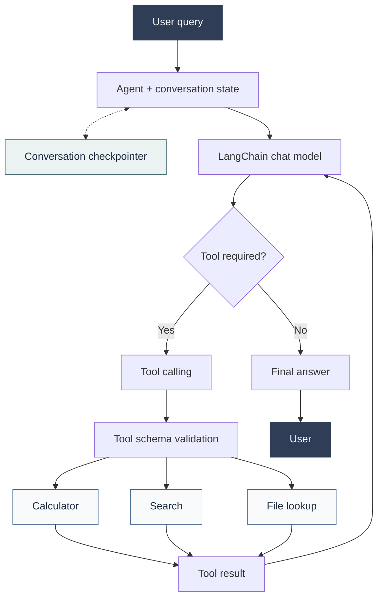

## Overview

This project is a LangChain-based rebuild of my
[ReAct Agent From Scratch](/projects/react-agent-from-scratch/), originally implemented in pure
Python without using an agent framework.

The goal is to recreate the same agent capabilities using LangChain's abstractions while
understanding what the framework handles internally and what developers still need to design
themselves.

Rather than simply using a framework to build an AI agent, this project focuses on understanding
the underlying concepts, comparing implementation approaches, and evaluating the trade-offs
between custom-built and framework-based solutions.

## Motivation

Building an agent from scratch helped me understand the core ReAct cycle:

- Reasoning about the next action
- Selecting and invoking tools
- Processing tool observations
- Continuing the execution loop until a final answer is produced

The next step is to rebuild this workflow using LangChain and explore how its abstractions
simplify agent development. This comparison provides a practical way to understand both the
fundamentals of agent systems and the tools commonly used to build them in production-oriented
applications.

## Key learning objectives

- **LangChain Expression Language (LCEL):** compose prompts, models, and output parsers using reusable Runnable components.
- **Structured tools:** define tools with explicit input schemas using Pydantic and LangChain's tool abstractions.
- **Tool calling:** connect language models to external functions and manage tool execution.
- **Agent development:** build an agent using LangChain's current agent interface.
- **Conversation memory:** maintain conversation state across multiple interactions.
- **Testing and evaluation:** test tool execution, multi-step tasks, error handling, and multi-turn conversations.

## Tools and capabilities

The project reuses the three tools from the original implementation to keep the comparison consistent.

- **Calculator:** performs basic arithmetic operations using validated structured inputs.
- **Search:** searches a small predefined demonstration dataset. This is a controlled local search tool, not a live web search integration.
- **File lookup:** performs bounded lookups within the project's permitted data files.

## Architecture

The intended execution flow is:

1. The user submits a question.
2. The agent passes the message and relevant conversation state to the language model.
3. The model decides whether to respond directly or request a tool.
4. If a tool is requested, the agent executes it.
5. The tool result is returned to the model.
6. The process continues until the agent produces a final response.
7. Conversation state is retained for subsequent messages within the same thread.

## Technology stack

Python · LangChain · LCEL · Pydantic · tool calling · LangGraph-based agent execution and state management · pytest · uv

## Evaluation plan

To make the comparison meaningful, the LangChain implementation will be evaluated against the
original from-scratch agent using equivalent tasks and tool capabilities. The evaluation focuses on:

- Successful execution of the same multi-tool task
- Correct tool selection and argument handling
- Multi-turn conversations with retained context
- Isolation between separate conversation threads
- Error handling and execution limits
- Code organization, complexity, and maintainability

## From scratch vs. LangChain

The two projects explore the same agent problem from different perspectives.

| Aspect | ReAct Agent From Scratch | LangChain Agent Rebuild |
|---|---|---|
| Implementation | Plain Python | LangChain |
| Agent loop | Explicitly implemented | Framework-managed |
| Tool definitions | Custom implementation | LangChain tools with schemas |
| Input validation | Custom logic | Pydantic schemas |
| Model interaction | Custom LLM wrapper | LangChain model abstractions |
| Conversation state | Custom implementation | LangChain/LangGraph state management |
| Main focus | Understanding agent fundamentals | Understanding framework abstractions and trade-offs |

## Expected outcome

The final result will be a working LangChain-based implementation of the original agent,
accompanied by tests, architecture documentation, and a practical comparison of both approaches.

## Status

**In development.** Implementation, testing, and the final comparison will be documented as the
project progresses.
