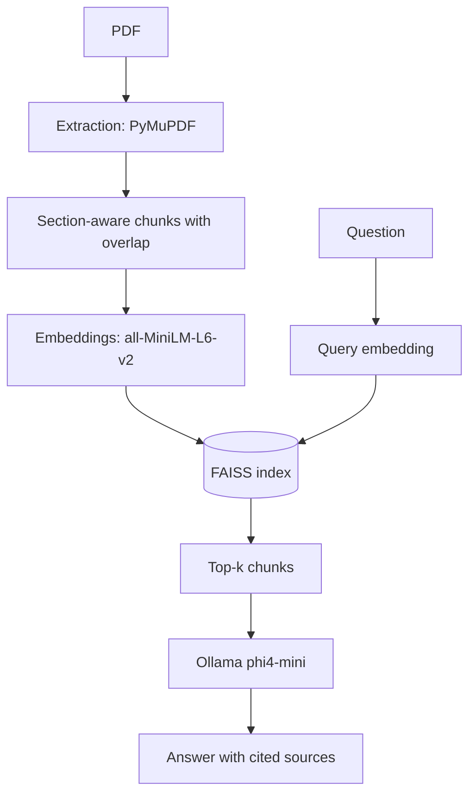

## Overview

A question-answering system over PDF books that runs entirely on a local machine: no hosted
LLM and no hosted vector database. Answers are generated only from retrieved passages and
come with source citations.

## Pipeline

## Design

- **Extraction and chunking:** PDF text extracted with PyMuPDF, split into section-aware chunks with overlap.
- **Retrieval:** embeddings from `all-MiniLM-L6-v2` and exact FAISS cosine-similarity search.
- **Generation:** a local Ollama model (`phi4-mini`) constrained to the retrieved context, with source citations.
- **Integrity checks:** the index and the document store are checked for alignment, and the embedding dimension is validated, so a stale index fails loudly instead of returning wrong passages.

## Evaluation

Retrieval was evaluated on a 68-question golden set.

| top-k | Context recall | Context precision |
|---|---|---|
| 3 | 0.7305 | 0.0445 |
| 5 | 0.8255 | 0.0427 |

Raising top-k from 3 to 5 increased context recall from 0.73 to 0.83. Context precision is low
in absolute terms and fell slightly, so the next step is an error analysis of the failed
questions before tuning chunk size or adding a reranker.

## Limitations and next steps

This is a learning project, not a production service. Automated tests and CI are not in place
yet. Planned: error analysis, chunk-size and reranker experiments, an API with Docker, and
generation-quality evaluation.
