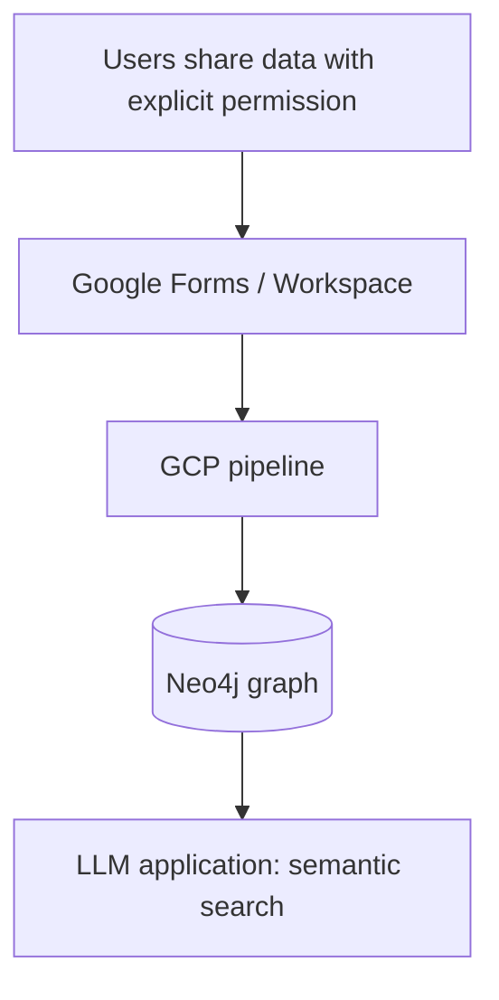

## Overview

Built at Goodfolio (London, remote) as part of a UK-based product team: a data pipeline that
collects professional profile data **only from users who voluntarily share it with explicit
permission**, models it in a Neo4j graph, and lets LLM applications retrieve relevant
insights through semantic search.

## Consent-based data collection

Users shared professional profile data (for example from LinkedIn) through Google Forms and
other Google Workspace tools, with explicit permission. The data flowed into Google Cloud
Platform, where LLMs analyzed it to power end-to-end service delivery.

## Graph-backed semantic search

Neo4j graph databases model the relationships in the collected data so an LLM application can
retrieve relevant context for a question instead of relying on plain keyword or vector lookup
alone.

## Prompting

Few-shot and structured prompting raised LLM output accuracy in production.

## Results

| Metric | Change |
|---|---|
| Relevant data-insight retrieval | ~30% improvement |
| LLM output accuracy | ~15% improvement |
