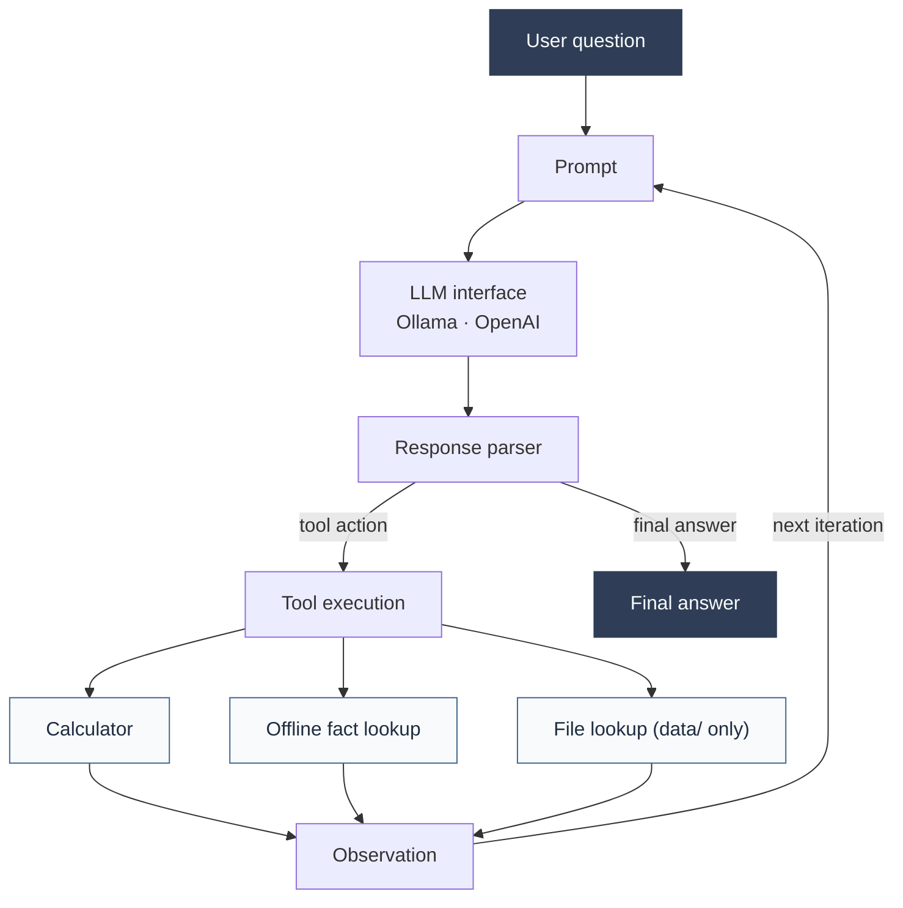

## Overview

ReAct Agent From Scratch implements a single-agent ReAct workflow with explicit control over model
interactions, tool execution, and the agent loop.

The agent receives a question, asks an LLM to produce either a tool action or a final answer,
executes valid tool calls, and feeds their results back as observations. Execution stops when the
agent returns a final answer or reaches its configured iteration limit.

Rather than delegating orchestration to an agent framework, the project separates the model
interface, prompt construction, response parsing, tool implementations, and execution loop into
focused Python modules.

## Key features

- **Unified LLM interface:** a single `chat()` interface supports Ollama and OpenAI configurations.
- **Explicit ReAct orchestration:** a bounded loop coordinates model responses, tool execution, observations, and final answers.
- **Constrained calculator:** arithmetic expressions are parsed and evaluated through an AST allowlist rather than Python's `eval()`.
- **Offline fact lookup:** a deterministic local lookup returns answers from four facts bundled with the project.
- **File access boundaries:** file lookup resolves requested paths and rejects paths outside the configured `data/` directory.
- **Error handling:** parser errors, unknown tools, and tool-function exceptions are returned to the model as observations.
- **Automated testing:** tests cover parsing, tool behavior, orchestration, LLM integration boundaries, and CLI behavior using controlled responses and fake clients.
- **Execution timing:** the agent trace records the elapsed duration of each complete LLM call.

## Architecture

The execution flow is intentionally explicit:

1. The prompt provides the task instructions and available tool descriptions.
2. The model returns a tool action or a final answer in the expected text format.
3. The parser converts the response into a structured action, final answer, or error.
4. The agent loop executes a valid tool and appends its output as an observation.
5. The model continues until it answers or the iteration limit is reached.

## Engineering considerations

The implementation emphasizes modularity, deterministic testing, bounded execution, and clear
boundaries between model access and tool execution.

It also documents important limitations: text-based tool calling depends on model output quality;
the local lookup is not web search; file access controls are not a hardened multi-user sandbox; and
the manual model checks are exploratory rather than a statistically representative benchmark.

## Validation

Latest reported local validation:

- 81 tests passed, 1 skipped
- Ruff: all checks passed

The skipped test requires permission to create a symbolic link in the local environment. These
results describe the reported test environment and are not a guarantee across all platforms.

A small manual evaluation set (E01–E10) was also used to inspect calculator use, local lookup,
file lookup, direct answers, and basic tool-selection behavior. It is not a formal benchmark.

## Technology stack

Python 3.13 · OpenAI SDK · Ollama · uv · pytest · Ruff

## Status

**Completed — current version.** The current scope includes the ReAct execution loop, supported LLM
providers, built-in tools, CLI, automated tests, and project documentation.

Potential future extensions include an independent web search integration and a broader,
repeatable model-evaluation protocol.
