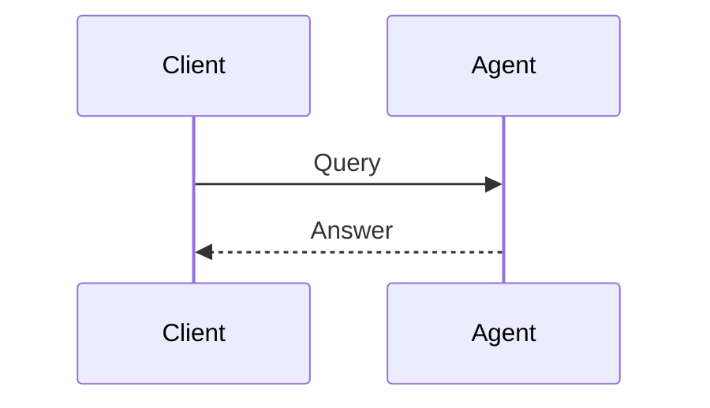

This page isn't a real project — it's `_research/style-guide.md`, kept out of any public
listing with `hidden: true` in its front matter, so you can visit it directly any time at
this URL without it needing a link anywhere. Every section below follows the same pattern:
**the exact Markdown you'd type**, then **what it actually looks like rendered**, right
underneath it — no guessing.

## Front matter

Every project file starts with a YAML block like this one. These fields drive the hero at
the top of the page:

```yaml
---
layout: research-project
order: 2                  # controls sort position if you build a listing from this collection
title: "Project Title"
subtitle: "One sentence used in the page hero and social preview cards."
description: "Used for the meta description tag."
status: "completed"               # or "in progress", "submitted", etc.
date: 2026-01-01
tags: ["#tag-one", "#tag-two"]
thumbnail: /assets/img/projects/your-cover.jpg   # optional cover image
links:
  code: "https://github.com/you/repo"            # optional
  demo: "https://..."                            # optional
  paper: "https://..."                           # optional
---
```

**Output:** this generates the hero block (title, subtitle, status pill, tags) at the top of
the page — nothing to render inline here since it's metadata, not body content. `hidden: true`
(used on this page) just means nothing else needs to link to it for it to still be reachable.

## Headings

**Code:**

```markdown
## A main section
### A subsection
```

**Output:** hover over any heading on this page and a small `#` appears on the right — that's
a permalink to that exact section, added automatically to every `##`/`###` on a project page.

### This heading is the subsection example

Subsections are for breaking a section like Method or Results into smaller pieces.

## Text formatting

**Code:**

```markdown
Standard Markdown: **bold text**, *italic text*, `inline code`, and [links](https://example.com).
```

**Output:** Standard Markdown: **bold text**, *italic text*, `inline code`, and
[links](https://example.com).

## Math

**Code:**

```markdown
Inline math sits in a sentence, like $E = mc^2$ or $d(x, y)$.

Display math goes on its own line:

$$
\nabla f(x) = \left( \frac{\partial f}{\partial x_1}, \dots, \frac{\partial f}{\partial x_n} \right)
$$
```

**Output:** Inline math sits in a sentence, like $E = mc^2$ or $d(x, y)$. Display math goes
on its own line:

$$
\nabla f(x) = \left( \frac{\partial f}{\partial x_1}, \dots, \frac{\partial f}{\partial x_n} \right)
$$

**One exception:** if your display math has a subscript immediately followed by `{`, like
`\max_{1 \le i \le n}`, wrap it in a plain `<div class="math-block">` — this stops the
Markdown parser from misreading the underscore as emphasis.

**Code:**

```markdown
<div class="math-block">
$$
f(c) = \max_{1 \le i \le n} \; \text{sim}(c, s_i)
$$
</div>
```

**Output:**

<div class="math-block">
$$
f(c) = \max_{1 \le i \le n} \; \text{sim}(c, s_i)
$$
</div>

## Images

A plain image, centered and rounded automatically:

**Code:**

```markdown

```

**Output:**


For a captioned figure, use raw HTML directly in the Markdown:

**Code:**

```markdown
<figure class="research-figure">
  
  <figcaption>Caption text goes here.</figcaption>
</figure>
```

**Output:**

<figure class="research-figure">
  
  <figcaption>Caption text goes here.</figcaption>
</figure>

## Tables

**Code:**

```markdown
| Method | Accuracy | Runtime (s) |
|---|---|---|
| Baseline | 0.71 | 0.4 |
| Ours | 0.91 | 1.8 |
```

**Output:**

| Method | Accuracy | Runtime (s) |
|---|---|---|
| Baseline | 0.71 | 0.4 |
| Ours | 0.91 | 1.8 |

## Code blocks

Triple backticks with a language tag get automatic syntax highlighting, a copy button, and a
rounded themed box.

**Code:**

````markdown
```python
def score_pair(a, b, model):
    """Semantic similarity score for a sentence pair."""
    return model.similarity(a, b)
```
````

**Output:**

```python
def score_pair(a, b, model):
    """Semantic similarity score for a sentence pair."""
    emb_a = model.encode(a)
    emb_b = model.encode(b)
    return cosine_similarity(emb_a, emb_b)
```

## Footnotes

**Code:**

```markdown
A claim that needs a source[^1].

[^1]: Author, A. (2026). *Paper Title*. Venue.
```

**Output:** a claim that needs a source[^1] — scroll to the bottom of this page to see the
numbered reference list Kramdown generates automatically, with a back-link (↩) to jump back
up to exactly where you were reading.

## Diagrams

Write a diagram as plain text — flowcharts, sequence diagrams, state machines, and more —
using [Mermaid](https://mermaid.js.org/) syntax in a fenced code block, and it renders as an
SVG in the browser.

**Code:**

````markdown

````

**Output:**


mermaid.js is only loaded from CDN on pages that actually contain a diagram, so it doesn't
add weight to every project page.

## Video and audio

Self-hosted files use plain HTML5 tags directly in the Markdown — no plugin needed.

**Code:**

```markdown
<video controls>
  <source src="/assets/video/your-clip.mp4" type="video/mp4">
</video>
```

**Output:**

<video controls></video>

For an embedded YouTube/Vimeo video, wrap the `<iframe>` in `research-video` for a responsive
16:9 box that scales with the column width instead of overflowing on mobile:

**Code:**

```markdown
<div class="research-video">
  <iframe src="https://www.youtube.com/embed/VIDEO_ID" title="Video title" allowfullscreen></iframe>
</div>
```

**Output:** a 16:9 box the same width as this text column — actual video omitted here since
it needs a real `VIDEO_ID`:

<div class="research-video" style="background:var(--paper); display:flex; align-items:center; justify-content:center; color:var(--ink-faint); font-family:var(--mono-font); font-size:13px;">16:9 responsive box — your embedded video goes here</div>

## Code tabs

For showing the same snippet in multiple languages, use a `code-tabs` block — click a tab to
switch which code panel shows. Each panel needs its own fenced code block, and `markdown="1"`
on every nested `<div>` so kramdown parses the Markdown inside instead of treating it as raw
HTML — copy the structure below rather than freehanding it:

**Code:**

````markdown
<div class="code-tabs" markdown="1">
<div class="code-tabs-nav">
  <button class="code-tab-btn active" data-tab="python">Python</button>
  <button class="code-tab-btn" data-tab="js">JavaScript</button>
</div>

<div class="code-tabs-panel active" data-tab="python" markdown="1">
```python
def hello():
    return "hi"
```
</div>

<div class="code-tabs-panel" data-tab="js" markdown="1">
```js
function hello() { return "hi"; }
```
</div>

</div>
````

**Output** — try clicking the tabs, or press Tab to focus one and use the arrow keys:

<div class="code-tabs" markdown="1">
<div class="code-tabs-nav">
  <button class="code-tab-btn active" data-tab="python-demo">Python</button>
  <button class="code-tab-btn" data-tab="js-demo">JavaScript</button>
</div>

<div class="code-tabs-panel active" data-tab="python-demo" markdown="1">
```python
def hello():
    return "hi"
```
</div>

<div class="code-tabs-panel" data-tab="js-demo" markdown="1">
```js
function hello() { return "hi"; }
```
</div>

</div>

`active` on the first tab button and its matching panel controls which one shows by default.
Keyboard accessibility (arrow-key navigation, proper `role`/`aria-selected`) is applied
automatically at runtime — nothing extra to write by hand.

## Pseudocode

For an algorithm's pseudocode specifically (as opposed to real code), use a ` ```pseudocode `
fenced block with LaTeX `algorithmic`-style syntax — it renders as a properly typeset
algorithm box with line numbers, same as you'd see in a paper. **Use `$$...$$` for any math
inside it, never single `$`** — single `$` gets caught by the page's general math rendering
first and corrupts the raw syntax before the pseudocode renderer gets to parse it.

**Code:**

````markdown
```pseudocode
\begin{algorithm}
\caption{Cosine Similarity Ranking}
\begin{algorithmic}
\PROCEDURE{RankBySimilarity}{$$q, D$$}
    \STATE $$scores \gets \emptyset$$
    \FOR{$$d \in D$$}
        \STATE $$scores[d] \gets$$ \CALL{Cosine}{$$q, d$$}
    \ENDFOR
    \RETURN \CALL{SortDescending}{$$scores$$}
\ENDPROCEDURE
\end{algorithmic}
\end{algorithm}
```
````

**Output:**

```pseudocode
\begin{algorithm}
\caption{Cosine Similarity Ranking}
\begin{algorithmic}
\PROCEDURE{RankBySimilarity}{$$q, D$$}
    \STATE $$scores \gets \emptyset$$
    \FOR{$$d \in D$$}
        \STATE $$scores[d] \gets$$ \CALL{Cosine}{$$q, d$$}
    \ENDFOR
    \RETURN \CALL{SortDescending}{$$scores$$}
\ENDPROCEDURE
\end{algorithmic}
\end{algorithm}
```

## Links section

If a project has `links.code`, `links.demo`, or `links.paper` set in its front matter, they
appear automatically as buttons at the bottom of the page — no need to add them manually in
the body. Any you leave out just don't appear; you can have one, two, or all three.

**Code (front matter, not body content):**

```yaml
links:
  code: "https://github.com/you/repo"
  demo: "https://your-demo-site.com"
  paper: "https://arxiv.org/abs/..."
```

**Output** — a hand-placed copy of the exact markup the layout generates automatically at the
bottom of a page when those fields are set (this page's own front matter has `links: {}`, so
nothing would normally show here — this is just to show you what it looks like):

<div class="research-links">
  <a href="#" onclick="return false;"><i class="fa-brands fa-github"></i> code</a>
  <a href="#" onclick="return false;"><i class="fa-solid fa-arrow-up-right-from-square"></i> demo</a>
  <a href="#" onclick="return false;"><i class="fa-solid fa-file"></i> paper</a>
</div>

[^1]: This is an example footnote — replace with a real citation, e.g. Sadr Jahani, S. (2026). *Scoring Augmented Sentences Using Autoencoder and Siamese BERT*.
