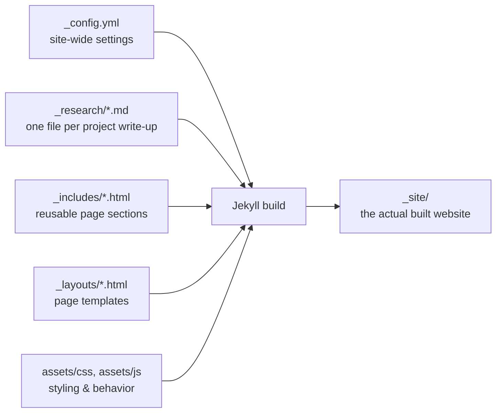

<div class="page-header">
  <span class="eyebrow">// guide.md</span>
  <h1>Site Architecture Guide</h1>
  <p class="lede">How this site is put together, what's editable and where, with real examples pulled straight from the current data files.</p>
</div>

<section>
<div class="research-body" markdown="1">

This page isn't linked anywhere in the nav — it's a private reference, same idea as
`/projects/style-guide/`, just for the site as a whole instead of one project page. Bookmark
it; you'll want to come back to it.

## The big picture

This is a Jekyll site. Jekyll takes plain text files (Markdown, YAML, JSON) and a set of
reusable HTML templates, and combines them at build time into the static HTML/CSS/JS that
actually gets served to visitors. Nothing runs on a server per-visit — the whole site is
pre-built once, then served as flat files. That's why editing content always means editing a
source file and rebuilding, never clicking a "save" button on a live page.



## Where everything lives — file tree

```
site/
├── _config.yml              site identity, contact info, color notes, collections
├── index.md                 homepage (hero + "what I work on")
├── research.md               /research/ narrative page
├── cv.md                     /cv/ page
├── projects.md                /projects/ listing page
├── news.md                    /news/ listing page
├── contact.md                 /contact/ page
├── guide.md                   this page
│
├── _data/                    JSON content — edit these for text changes
│   ├── education.json         CV → Education
│   ├── experience.json        CV → Experience
│   ├── research_experience.json  CV → Research Experience
│   ├── awards.json            CV → Honours & Awards
│   ├── skills.json            CV → Tools & Methods
│   ├── languages.json         CV → Languages
│   ├── volunteering.json      CV → Volunteering
│   ├── academic_service.json  CV → Academic Service (TA roles, workshops, conferences)
│   ├── references.json        CV → References
│   ├── projects.json          Projects grid
│   ├── news.json               News list
│   ├── home_focus.json        Home → "What I work on" (3 cards)
│   ├── tags.json               Home hero chips
│   └── research.json           Research page copy + focus cards
│
├── _research/                 ONE FILE PER PROJECT WRITE-UP — see below
│   ├── social-graph-analytics.md
│   ├── siamese-bert-sentence-scorer.md
│   ├── dynamic-pricing-optimizer.md
│   ├── traffic-flow-forecasting.md
│   ├── fraud-sentiment-detection.md
│   ├── ecommerce-pipeline-automation.md
│   ├── market-intelligence-web-scraping.md
│   ├── decision-making-dashboard.md
│   └── style-guide.md          (hidden reference page, not a real project)
│
├── _includes/                  reusable HTML sections, mostly data-driven
│   │   news.html, contact.html, timeline.html (reusable, parameterized)
│   ├── header-nav.html          top nav bar + mobile toggle
│   ├── footer-cta.html          "get in touch" strip above the footer
│   ├── katex-math.html          math rendering, loaded on project pages
│   └── person-jsonld.html       structured data for SEO (auto, no editing needed)
│
├── _layouts/
│   ├── default.html             wraps every normal page (nav + content + footer)
│   └── research-project.html    wraps each individual project write-up page
│
└── assets/
    ├── css/portfolio.css        all site styling (source of truth)
    ├── js/portfolio.js          all site interactivity
    ├── img/                     profile photo, wave motif
    └── cv-sara-sadr-jahani.pdf  the downloadable CV file — add this yourself

```

## Editing text content — the JSON files

Most sections of the site are driven by `_data/*.json`. Edit the file, save, and the dev
server (`docker compose up`) picks it up automatically — no HTML editing needed.

### `education.json` — CV → Education

```json
{
  "years": "2018 — 2022",
  "role": "MSc, Computer Science — Data Mining",
  "org": "Institute for Advanced Studies in Basic Sciences (IASBS), Zanjan",
  "description": "GPA: 17.38/20. Thesis: Scoring Augmented Sentences Using Autoencoder and Semantic Textual Similarity (STS) with Siamese BERT. Courses: Advanced AI, Computational Data Mining, ..."
}
```
`description` is optional — omit the field entirely if an entry doesn't need one.

### `experience.json` / `research_experience.json` — CV → Experience sections

Same shape as `education.json` (`years`, `role`, `org`, optional `description`). Newest entry
goes first in the array — array order is page order.

### `academic_service.json` — CV → Academic Service

```json
{ "type": "teaching assistant", "title": "Data Mining Course", "org": "IASBS", "date": "Spring 2020" }
```
`type` is free text shown next to the organization (existing values in use: `"teaching
assistant"`, `"workshop"`, `"conference"`) — it's just a label, not a controlled vocabulary,
so you can introduce new categories any time.

### `awards.json` — CV → Honours & Awards

```json
{ "years": "2011", "role": "Silver & Bronze Medal", "org": "International Inventions Competitions, Kuwait" }
```

### `skills.json` / `languages.json` — CV → Tools & Methods / Languages

```json
["Python", "PyTorch", "R", "SQL", "NLP", "..."]
```
```json
{ "name": "German", "level": "A1" }
```
`skills.json` is a flat array of strings. `languages.json` is an array of `name`/`level`
objects.

### `references.json` — CV → References

```json
{ "name": "Prof. Mahdi Bohlouli", "title": "Former Chair at IASBS", "email": "me@bohlouli.com" }
```
**Note:** the CV page currently only prints `name` and `title` — `email` is stored but not
rendered, so referee contact details aren't published on the live site. If you'd rather show
"available on request" text instead of a names list, that's a one-line edit in
`_includes/cv.html`.

### `projects.json` — Projects grid

```json
{
  "num": "01",
  "title": "Social Graph Analytics",
  "description": "A Neo4j-based graph database extracting insight from social media data, powered by LLMs and an AI agent layer.",
  "tags": ["Neo4j", "LLM Agents", "GCP"],
  "link": "/projects/social-graph-analytics/"
}
```
`link` should point at the matching file in `_research/` (see below) — leave it as an empty
string `""` if that project doesn't have a full write-up yet.


### `news.json` — News list

```json
{
  "date": "Apr 2025",
  "html": "Wrapped up a Data Scientist role at <strong>Goodfolio</strong> (London, remote), building Neo4j graph databases..."
}
```
`html` accepts raw HTML including links and `<strong>` tags.

## Adding a project write-up

Every project card on `/projects/` can link to a full write-up page with math, images, code,
pseudocode, diagrams, and more. **Full detail with every formatting option lives at
`/projects/style-guide/`** — this is the short version:

1. Copy an existing file in `_research/`, e.g. `_research/siamese-bert-sentence-scorer.md`, to
   a new file — the filename becomes the URL (`_research/my-project.md` → `/projects/my-project/`).
2. Edit the front matter: `title`, `subtitle`, `description`, `status`, `date`, `tags`,
   `order`, optional `thumbnail` and `links`.
3. Write the body in Markdown below the `---`.
4. Point that project's `link` field in `_data/projects.json` at the new URL.

Add `hidden: true` to keep a write-up off any public listing while its page stays live at its
own URL — that's how `_research/style-guide.md` itself stays out of the way while still being
reachable.

## Site-wide settings — `_config.yml`

```yaml
title: "Sara Sadr Jahani"
author: Sara Sadr Jahani
email: sarasadrjahani@gmail.com
phone: "+98 912 599 2674"
location: "Tehran, Iran"
job_title: "Data Scientist"        # feeds the Person structured data (SEO)
hero_bio: "..."                     # the paragraph under your name on the homepage
avatar: /assets/img/profile.jpg
cv_pdf: /assets/cv-sara-sadr-jahani.pdf
socials:                            # contact links + Person "sameAs" data
  - icon: "fa-solid fa-envelope"
    url: "mailto:..."
```
Editing `_config.yml` needs a container restart to take effect (`docker compose restart`),
unlike `_data/*.json`, which live-reloads.

## Changing colors

The entire palette is CSS custom properties at the top of `assets/css/portfolio.css`:

```css

--paper: #F3F0E8;        /* card / code-block background */
--ink: #1B1A17;           /* primary text */
--ink-soft: #5B584E;      /* body copy */
--ink-faint: #8C887C;     /* meta text, timestamps */
--accent: #34415E;        /* primary accent — links, buttons */
--accent-warm: #8B6F47;   /* secondary accent */
--accent-2: #6B4F8C;      /* tertiary accent — used in code syntax coloring */
```
This site uses a single warm-paper palette (no dark mode toggle), so there's only one set of
tokens to change.

## Running the site locally

```
docker compose up
```
Then open `http://localhost:4000`. Editing any file under `site/` and saving triggers an
automatic rebuild and browser refresh — no restart needed (except `_config.yml`, see above).
Full details are in `SETUP.md` at the project root.

</div>
</section>
